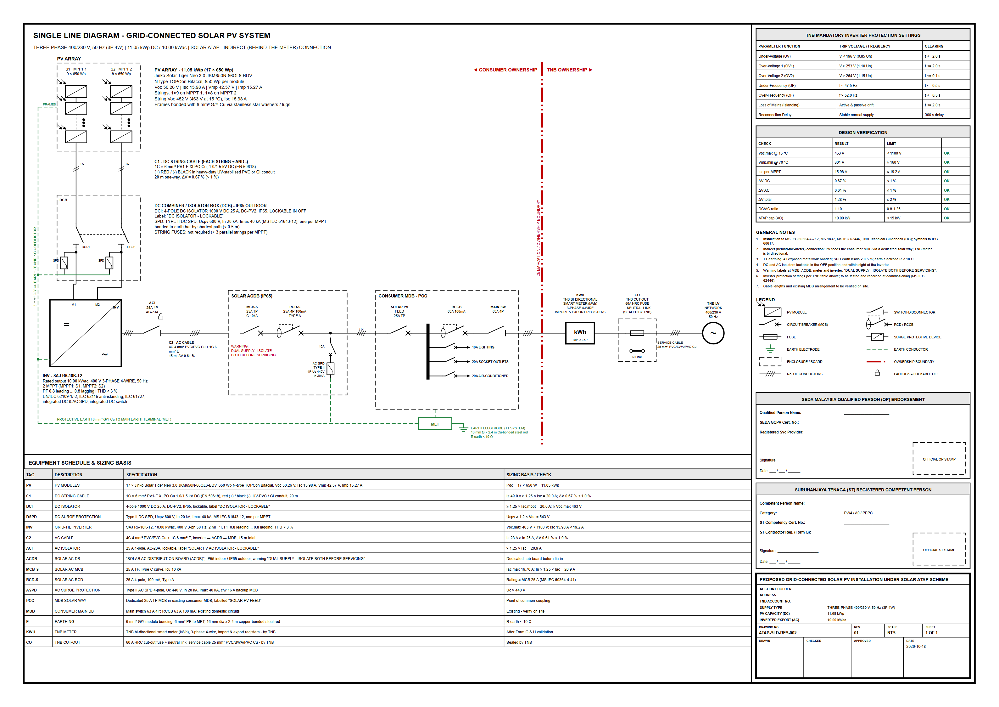

# SLD Drawing AI

**A toolkit that lets a person or an AI agent produce Malaysian Solar ATAP residential
Single Line Diagrams (SLDs): A3 PDFs with sizing calculations and compliance checks.**

You (or an agent) describe the job. The toolkit sizes every protective device and cable
using the rules in [`docs/specification.md`](docs/specification.md), checks the design,
and draws a submission-style A3 sheet:



Every number on the drawing comes from deterministic code. The AI's job is only to
collect the job details and handle the conversation, never to do the engineering
arithmetic.

## Install in one line

**Windows** (PowerShell):
```powershell
irm https://raw.githubusercontent.com/Zhihong0321/sld-generator/main/install.ps1 | iex
```

**macOS / Linux:**
```bash
curl -fsSL https://raw.githubusercontent.com/Zhihong0321/sld-generator/main/install.sh | bash
```

The installer downloads the repo to `~/sld-generator` (set `SLD_HOME` to change it),
installs the `sldgen` command, and runs a health check. Run it again to update; your
`projects/` and `library/` are kept. You need Python 3.10+ and Edge or Chrome. Git is
optional.

**Using an AI agent?** Give it this link:

> Install https://github.com/Zhihong0321/sld-generator and follow its AGENTS.md.

The agent then asks you the job questions (phase, panel model and quantity, inverter
model, plus optional cable lengths and title-block details) and generates the PDF. If
you already know the details, add them to the same message, e.g. *"…to generate an SLD
for: 3-phase, 17 × Jinko 650 W, SAJ R6-10K"*, and it skips the questions it doesn't need.

---

## What's in the bundle

| Part | Path | What it gives you |
|---|---|---|
| **Engine** | `sldgen/` | Calculations, compliance checks, A3 drawing, PDF export |
| **Command-line tools** | `sldgen …` | `init`, `check`, `build`, `library`, `schema` - see [docs/TOOLS.md](docs/TOOLS.md) |
| **Rules** | `sldgen/rules.py` | Every limit, factor and standard size, in one editable file |
| **Equipment library** | `library/*.json` | PV module and inverter datasheet values (verified entries flagged) |
| **Templates** | `templates/` | Project file, intake checklist, library entry templates |
| **Schema** | `schema/project.schema.json` | JSON Schema for the project file, so tools and agents can validate it |
| **Agent playbook** | [`AGENTS.md`](AGENTS.md) | Step-by-step workflow that teaches any AI agent to run the pipeline |
| **Claude Code skill** | `.claude/skills/sld-generator/` | Same playbook, auto-loaded by Claude Code |
| **Examples** | `examples/` | Worked projects (three-phase, single-phase with string fuses) |

## How it works

```
 you / customer docs ──►  AI agent  ──►  project.json  ──►  sldgen check  ──►  sldgen build  ──►  A3 PDF
 (chat, quote, bill,     (AGENTS.md)     (templates/,       (rules.py:         (render +          + PNG preview
  datasheet PDFs)                         schema/)           sizing, limits)    Edge/Chrome)       + design report
```

1. **Intake.** The agent gathers the job details using `templates/intake-checklist.md`.
2. **Equipment.** The module and inverter are looked up in `library/`. A new model is
   added from its datasheet.
3. **Project file.** One JSON file per job (`sldgen init` writes it).
4. **Check.** `sldgen check` runs every §3 calculation and rule. Errors block the build.
5. **Build.** `sldgen build` writes the PDF, a PNG preview, the SVG, and a markdown design report.

---

## Quick start (by hand, no AI)

Requirements: **Python 3.10+** and **Microsoft Edge or Google Chrome**, which is used
headless to print the PDF. No other dependencies. Use the one-line installer above, or
do it manually:

```bash
git clone https://github.com/Zhihong0321/sld-generator.git
cd sld-generator
pip install -e .
```

```bash
sldgen init projects/JOB-001.json --phase 3 --module jinko-jkm650n-66ql6-bdv --inverter saj-r6-10k-t2 --strings 9,8
sldgen check projects/JOB-001.json
sldgen build projects/JOB-001.json
```

The output goes to `output/<drawing_no>/`. Skip `pip install` if you prefer: use
`python -m sldgen …` from the repo folder.

## Use it with an AI agent

The playbook lives in **[`AGENTS.md`](AGENTS.md)**. Most coding agents read that file
automatically when they open the folder:

| Agent | How to start |
|---|---|
| **Claude Code** (CLI, desktop, IDE) | Open the folder and say *"new SLD"*. The `sld-generator` skill loads itself and asks the job questions. |
| **OpenAI Codex CLI, Cursor, GitHub Copilot, Gemini CLI, Windsurf** | Open the folder and say *"new SLD"*. They read `AGENTS.md` (Gemini via `GEMINI.md`, Copilot via `.github/copilot-instructions.md`). |
| **Aider** | Start with `aider --read AGENTS.md`, then say *"new SLD"*. |
| **Any other agent that can run shell commands** | First message: *"Read AGENTS.md in this repo and follow it to generate an SLD for …"* |
| **An agent that doesn't have the repo yet** | *"Install https://github.com/Zhihong0321/sld-generator, then follow its AGENTS.md to …"*. It runs the installer and `cd`s in. |
| **Chat-only assistants (no shell)** | Not supported yet. They need the planned MCP server (see Roadmap). |

Example request:

> 3-phase, 17 × Jinko Tiger Neo 3.0 650 W, SAJ R6-10K. Customer Ahmad bin Abdullah,
> TNB 220012345678, 12 Jalan Setia 3/5 Shah Alam. DC run 25 m, AC run 12 m.

If you just say *"new SLD"*, the agent replies with the intake questions (see
[AGENTS.md → Start here](AGENTS.md#start-here-your-first-reply)). Either way it asks
at most one follow-up, then hands back the PDF and lists any warnings and the
submission fields that are still blank.

---

## Repository map

```
AGENTS.md                      agent playbook (source of truth for AI workflows)
CLAUDE.md / GEMINI.md          point Claude Code / Gemini CLI at AGENTS.md
.github/copilot-instructions.md  points GitHub Copilot at AGENTS.md
README.md                      this file
install.ps1 / install.sh       one-line installers (Windows / macOS-Linux)
pyproject.toml                 makes `sldgen` an installable command
sldgen/                        the engine
  rules.py                       limits, factors, standard sizes  <- edit to change rules
  calc.py                        calculations + compliance checks
  render.py                      A3 SVG drawing
  export.py                      PDF/PNG via headless Edge/Chrome
  project.py                     project loading + library lookup
  report.py                      markdown design report
  __main__.py                    command-line tools
library/                       equipment datasheet library (modules.json, inverters.json)
templates/                     project.json, intake-checklist.md, module.json, inverter.json
schema/project.schema.json     project file JSON Schema
examples/                      worked example projects
projects/                      your jobs (one JSON per job)
output/                        generated drawings (not committed)
docs/
  GUIDE.md                       how to use the repo, end to end
  TOOLS.md                       command reference
  specification.md               the engineering ruleset the engine implements
```

## Documentation

- **[docs/GUIDE.md](docs/GUIDE.md)**: the full workflow, adding equipment, revisions, changing rules
- **[docs/TOOLS.md](docs/TOOLS.md)**: every command, its options, exit codes and JSON output
- **[AGENTS.md](AGENTS.md)**: what an AI agent must do and must never do
- **[docs/specification.md](docs/specification.md)**: the engineering ruleset (§ numbers referenced in code)

## Limits and responsibility

- This is a **design aid**. A SEDA Qualified Person and an ST Competent Person must review,
  sign and stamp every drawing. The toolkit never fills in signatures, stamps or
  certificate numbers it wasn't given.
- Library entries marked `"verified": false` print **"PRELIMINARY - EQUIPMENT DATA NOT VERIFIED"**
  on the sheet. Verify the values against the manufacturer datasheet before submission.
- The ATAP capacity cap is checked against inverter kWac (error) and array kWp (warning).
  Confirm the current SEDA/TNB quota rules.

## Roadmap

- MCP server, so chat-based assistants can call `check` and `build` as tools
- DXF export for AutoCAD touch-ups
- Hybrid inverter and battery topologies
